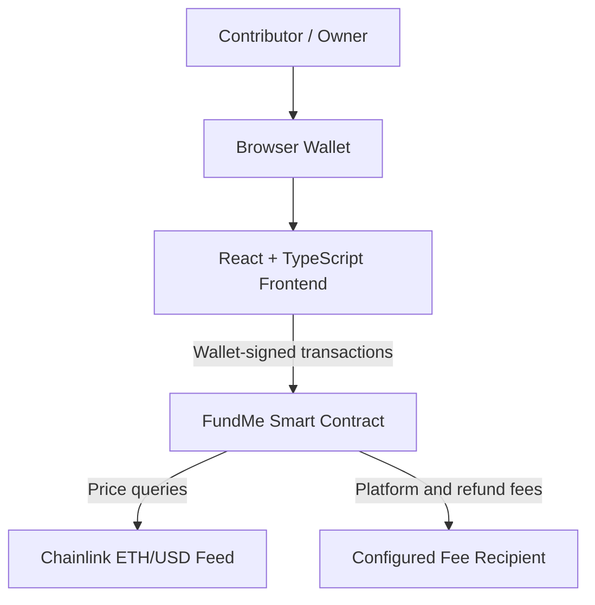
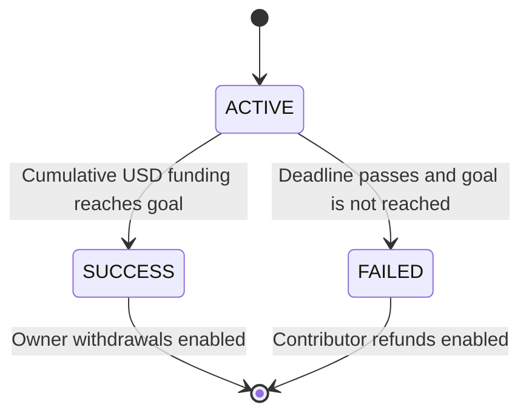
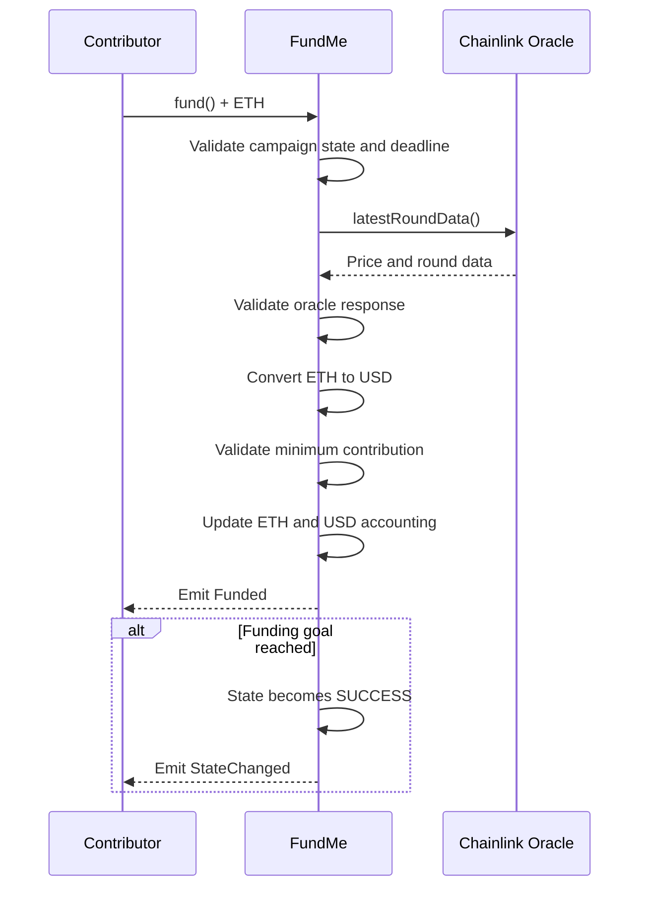
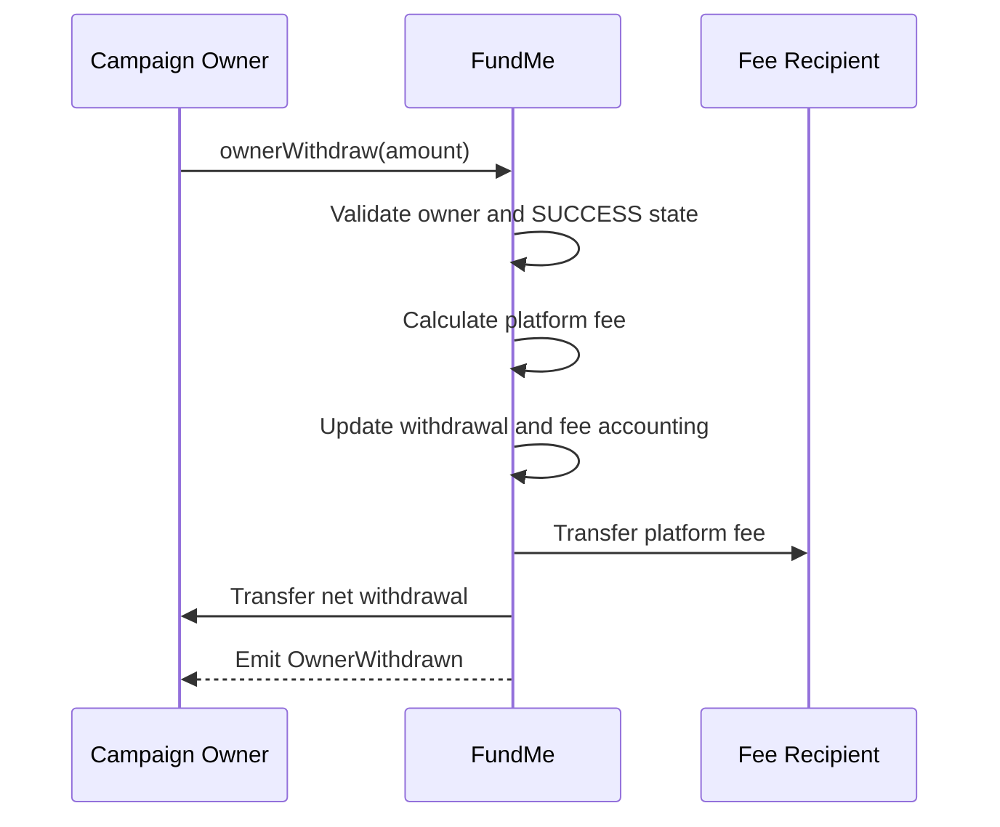
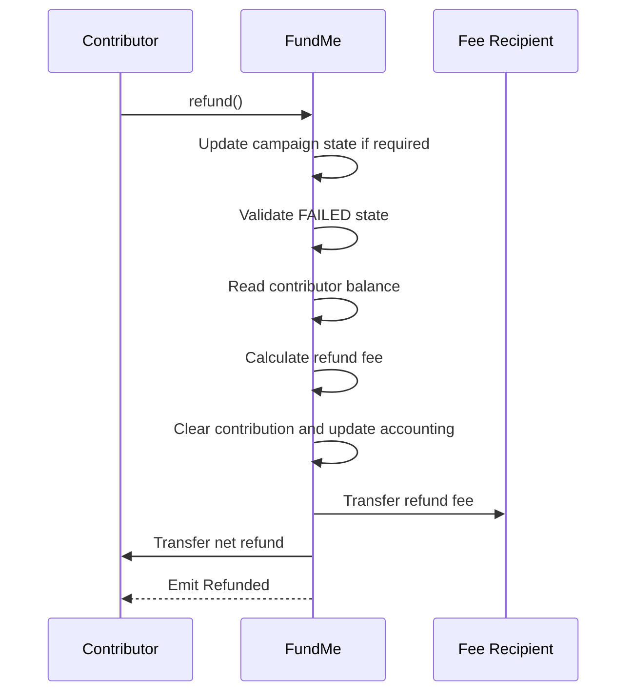

# Secure CrowdFunding Protocol — Ethereum Crowdfunding Application

[](https://github.com/barnabasmunuhe/Secure-Crowd_Funding-Protocol/actions/workflows/test.yml)
[](https://soliditylang.org/)
[](https://book.getfoundry.sh/)
[](https://github.com/crytic/slither)
[](https://sepolia.etherscan.io/)

> **Testnet engineering project:** A smart-contract-based crowdfunding application with USD-denominated funding rules, Chainlink ETH/USD price conversion, fee-aware withdrawals and refunds, and a state-driven campaign lifecycle.

Secure CrowdFunding Protocol is an Ethereum crowdfunding application built with Solidity and Foundry. It allows contributors to fund a campaign using ETH while measuring contributions against a USD-denominated funding goal and minimum contribution.

The protocol uses Chainlink Price Feeds to convert ETH contributions into USD values. Campaign outcomes are enforced by the smart contract: successful campaigns enable owner withdrawals, while failed campaigns enable contributors to claim refunds.

**Live Application:** https://secure-crowd-funding-protocol.vercel.app/

**Network:** Ethereum Sepolia Testnet

**Smart Contract:** [View on Sepolia Etherscan](https://sepolia.etherscan.io/address/0x537e0E1B28187371b8f3C6516b62c170975bec2b)

📄 **Technical Whitepaper:** [Secure CrowdFunding Protocol — Technical Whitepaper v1.0 (PDF)](https://github.com/barnabasmunuhe/Secure-Crowd_Funding-Protocol/blob/main/docs/whitepaper/Secure_CrowdFunding_Protocol_Whitepaper.pdf)

---

## Table of Contents

- [Overview](#overview)
- [Why It Matters](#why-it-matters)
- [At a Glance](#at-a-glance)
- [Non-Production Scope](#non-production-scope)
- [Architecture](#architecture)
- [Core Components](#core-components)
- [Functional Scope](#functional-scope)
- [Campaign Lifecycle](#campaign-lifecycle)
- [Core Financial Flows](#core-financial-flows)
  - [Contribution and USD Valuation](#contribution-and-usd-valuation)
  - [Successful Campaign and Withdrawals](#successful-campaign-and-withdrawals)
  - [Failed Campaign and Refunds](#failed-campaign-and-refunds)
- [Fee Model and Economic Parameters](#fee-model-and-economic-parameters)
- [Oracle Integration and Price Safety](#oracle-integration-and-price-safety)
- [Security Model](#security-model)
  - [Checks-Effects-Interactions](#checks-effects-interactions)
  - [Reentrancy Protection](#reentrancy-protection)
  - [Access Control](#access-control)
  - [Input and Configuration Validation](#input-and-configuration-validation)
- [Static Analysis](#static-analysis)
- [Protocol Invariants](#protocol-invariants)
- [Events and Accounting](#events-and-accounting)
- [Getting Started](#getting-started)
  - [Prerequisites](#prerequisites)
  - [Installation](#installation)
  - [Build and Test](#build-and-test)
- [Running Tests](#running-tests)
- [Deployment](#deployment)
- [Frontend Integration](#frontend-integration)
- [Limitations and Roadmap](#limitations-and-roadmap)
- [Production Hardening Checklist](#production-hardening-checklist)
- [Repository Structure](#repository-structure)
- [References](#references)
- [License](#license)

---

## Overview

Secure CrowdFunding Protocol implements a single-campaign crowdfunding system centered around one `FundMe` smart contract.

The contract enforces campaign rules directly on-chain rather than relying exclusively on an external application or centralized service.

The protocol focuses on:

- ETH contributions with USD-denominated funding thresholds.
- Chainlink ETH/USD price conversion.
- Minimum contribution validation.
- Deterministic campaign state transitions.
- Owner withdrawals after successful funding.
- Contributor refunds after unsuccessful campaigns.
- Configurable platform and refund fees.
- Secure ETH transfers and transparent accounting.

### Why It Matters

Traditional crowdfunding applications commonly rely on centralized services to maintain campaign balances, determine funding outcomes, and process payouts or refunds.

A smart-contract-based approach makes these rules publicly inspectable and enforceable.

This project explores three important engineering concerns:

1. **Financial correctness:** How are ETH contributions valued against a USD funding target?
2. **State consistency:** How does the contract determine whether funds can be withdrawn or refunded?
3. **Secure fund handling:** How are withdrawals, refunds and fees processed without compromising accounting?

The objective is to demonstrate transparent campaign logic, oracle integration, secure ETH handling and disciplined smart-contract testing.

## At a Glance

| Parameter | Configuration |
|---|---|
| Funding asset | ETH |
| Accounting currency | USD |
| Funding goal | $10,000 |
| Minimum contribution | $5 |
| Campaign duration | 7 days |
| Platform fee | 2% (200 BPS) |
| Refund fee | 1% (100 BPS) |
| Maximum configurable fee | 5% (500 BPS) |
| Oracle | Chainlink ETH/USD |
| Network | Ethereum Sepolia |
| Solidity | 0.8.33 |
| Framework | Foundry |
| Static analysis | Slither 0.11.6 |

These are the documented Sepolia deployment configuration values. The deployed contract's immutable parameters are authoritative for that instance.

## Non-Production Scope

This project is a testnet engineering demonstration, not an independently audited financial application.

Current scope:

- Single campaign per contract deployment.
- ETH-only contributions.
- Immutable campaign configuration.
- Chainlink ETH/USD price feed dependency.
- Manual contributor-initiated refunds.
- Owner-controlled withdrawals.
- No on-chain governance or DAO.

The Sepolia deployment is intended for experimentation and technical review. Test ETH has no intended real-world monetary value.

## Architecture

The application separates the user interface, smart-contract execution, oracle dependency and fee recipient.



### Architecture Boundaries

- **Frontend:** Presents campaign information and provides wallet-based interactions.
- **Wallet:** Signs transactions initiated by contributors and the campaign owner.
- **FundMe:** Enforces campaign rules, stores contributions, maintains campaign state and handles payouts.
- **Chainlink:** Supplies the ETH/USD reference price used for contribution valuation.
- **Fee recipient:** Receives configured fees during withdrawal and refund operations.
- **Vercel:** Hosts the frontend application; it does not execute campaign settlement logic.

The frontend does not custody contributor funds. The smart contract is the authority for campaign state and contract-held ETH.

## Core Components

### FundMe.sol

The primary protocol contract.

Responsibilities:

- Campaign initialization and configuration.
- Contribution validation and accounting.
- Campaign state management.
- Successful campaign withdrawals.
- Failed campaign refunds.
- Platform and refund fee accounting.
- Event emission and public view functions.

The contract inherits:

- OpenZeppelin `Ownable`
- OpenZeppelin `ReentrancyGuard`

### PriceConverter.sol

The ETH/USD conversion library.

Responsibilities:

- Reading Chainlink `latestRoundData()`.
- Validating oracle responses.
- Checking price freshness.
- Normalizing price decimals.
- Converting ETH amounts into USD values.

### HelperConfig.s.sol

Provides network-specific deployment configuration, including:

- Chainlink price feed address.
- Funding goal.
- Minimum contribution.
- Campaign duration.
- Platform fee.
- Refund fee.
- Fee recipient.

### DeployFundMe.s.sol

Deploys the `FundMe` contract using the active network configuration.

### Frontend

The web application provides wallet connectivity, campaign information and transaction interfaces.

Technology stack documented for the frontend:

- React
- TypeScript
- Vite
- wagmi
- viem
- TanStack Query

## Functional Scope

| Capability | Description |
|---|---|
| ETH funding | Accepts ETH contributions through `fund()` |
| USD valuation | Converts ETH contributions using Chainlink |
| Minimum contribution | Enforces a USD-denominated minimum |
| Campaign states | ACTIVE, SUCCESS and FAILED |
| Finalization | Allows permissionless finalization after the deadline |
| Owner withdrawal | Allows withdrawals from successful campaigns |
| Contributor refunds | Allows refunds from failed campaigns |
| Platform fees | Deducts configured fees from successful withdrawals |
| Refund fees | Deducts configured fees from contributor refunds |
| Accounting | Tracks ETH contributions, USD values and fees |
| Events | Emits events for funding, withdrawals, refunds and state changes |

## Campaign Lifecycle

The campaign is represented by the `FundMeState` enum:

```solidity
enum FundMeState {
    ACTIVE,
    SUCCESS,
    FAILED
}
```

The campaign begins in `ACTIVE` and can transition into either `SUCCESS` or `FAILED`.



### ACTIVE

- Accepts eligible ETH contributions.
- Requires the current timestamp to be before the campaign deadline.
- Validates the USD value of each contribution.
- Changes to `SUCCESS` when cumulative USD funding reaches the goal.

### SUCCESS

- The funding goal has been reached.
- The campaign owner can call `ownerWithdraw()`.
- Contributors cannot claim failed-campaign refunds.

### FAILED

- The deadline has passed.
- The funding goal was not reached.
- Contributors can claim their individual refunds through `refund()`.

### Permissionless Finalization

Any address can call `finalizeCampaign()` after the deadline while the campaign remains active.

The contract evaluates the recorded cumulative USD contribution value and transitions the campaign into the appropriate terminal state.

Terminal states do not return to `ACTIVE`.

## Core Financial Flows

### Contribution and USD Valuation

Contributions are submitted in ETH, but the campaign goal and minimum contribution are denominated in USD.

The contract reads the ETH/USD price from Chainlink and converts the contribution into an 18-decimal USD value.

The conversion follows:

```text
USD Value = ETH Amount (wei) × ETH/USD Price (18 decimals) / 1e18
```

The Chainlink ETH/USD feed reports its answer with 8 decimals. The conversion library normalizes the price to 18 decimals before performing the calculation.

Example:

```text
ETH/USD price:       $2,000
ETH contribution:    0.01 ETH
Calculated value:    $20
```

The actual value depends on the oracle answer used by the transaction.

### Contribution Flow



Each accepted contribution updates:

- Contributor's recorded ETH contribution.
- Total ETH funded.
- Cumulative USD contribution value.

The USD value is recorded at contribution time. Historical contributions are not continuously re-priced when the oracle changes.

### Successful Campaign and Withdrawals

When cumulative USD contributions reach or exceed the funding goal, the campaign becomes `SUCCESS`.

Only the contract owner can withdraw funds.

The `ownerWithdraw(uint256 amount)` function supports:

- Partial withdrawals.
- Full balance withdrawals by passing `0` as the amount.

The contract calculates the platform fee, transfers the fee to the configured fee recipient and transfers the remaining amount to the owner.



### Failed Campaign and Refunds

If the deadline passes without reaching the funding goal, the campaign becomes `FAILED`.

Contributors can individually call `refund()` to recover their recorded contributions, less the configured refund fee.

The refund process:

1. Updates campaign state when required.
2. Checks that the campaign is `FAILED`.
3. Retrieves the contributor's recorded amount.
4. Calculates the refund fee.
5. Clears the contributor's recorded contribution.
6. Updates fee accounting.
7. Transfers the refund and fee.



Refunds are individually claimed. The contract does not automatically distribute refunds to all contributors.

## Fee Model and Economic Parameters

The protocol uses basis points (BPS) for fee calculations.

```text
1%  = 100 BPS
2%  = 200 BPS
5%  = 500 BPS
100% = 10,000 BPS
```

The fee denominator is:

```solidity
uint256 public constant BASIS_POINTS = 10_000;
```

The maximum permitted fee is:

```solidity
uint256 public constant MAX_FEE_BPS = 500;
```

Each configured fee is capped at 500 BPS (5%).

### Fee Configuration

| Parameter | Value |
|---|---:|
| Platform fee | 200 BPS (2%) |
| Refund fee | 100 BPS (1%) |
| Maximum fee | 500 BPS (5%) |
| Fee recipient | Configured deployment address |

### Fee Calculations

```text
Platform Fee = Withdrawal Amount × Platform Fee BPS / 10,000

Owner Payout = Withdrawal Amount - Platform Fee

Refund Fee = Contributor Amount × Refund Fee BPS / 10,000

Contributor Refund = Contributor Amount - Refund Fee
```

All calculations use integer arithmetic in wei. Small amounts may involve rounding down.

The contract tracks cumulative fees collected through both successful withdrawals and failed-campaign refunds.

## Oracle Integration and Price Safety

The protocol uses Chainlink's `AggregatorV3Interface` to obtain the ETH/USD price.

Sepolia ETH/USD feed:

```text
0x694AA1769357215DE4FAC081bf1f309aDC325306
```

### Oracle Validation

Before using a price answer, the conversion logic validates:

- **Positive answer:** Rejects zero or negative prices.
- **Timestamp present:** Rejects `updatedAt == 0`.
- **Timestamp validity:** Rejects future timestamps.
- **Freshness:** Rejects prices older than the one-hour threshold.
- **Round completeness:** Rejects responses where `answeredInRound < roundId`.
- **Feed decimals:** The configured feed must report 8 decimals.

The constructor also validates that the configured price feed address is non-zero and contains contract code.

### Oracle Risk

These checks reduce exposure to invalid or stale oracle responses, but do not eliminate oracle risk.

The protocol remains dependent on:

- Chainlink feed availability.
- Oracle correctness.
- Network conditions.
- Price movements between transactions.
- Correct network-specific feed configuration.

The configured feed address and network must be checked before deployment.

Reference: [Chainlink Data Feeds Documentation](https://docs.chain.link/data-feeds)

## Security Model

The contract incorporates several defensive mechanisms.

| Risk | Current Control | Residual Consideration |
|---|---|---|
| Unauthorized withdrawal | OpenZeppelin `Ownable` | Owner key compromise remains a risk |
| Reentrancy | `ReentrancyGuard` on payout functions | Future external-call paths require review |
| Invalid oracle data | Positive answer, timestamp and round checks | Oracle integrity remains an external dependency |
| Stale oracle data | One-hour freshness threshold | Valid market prices can still change |
| Excessive fees | Maximum 500 BPS constructor limit | Fee configuration is immutable |
| Failed ETH transfers | Transfer result is checked | Rejecting recipients can block payout |
| Invalid campaign actions | Explicit state checks and custom errors | No emergency pause mechanism exists |

### Checks-Effects-Interactions

The payout functions follow the Checks-Effects-Interactions pattern.

In `refund()`:

- The contributor's recorded amount is cleared.
- Fee accounting is updated.
- ETH transfers are executed afterward.

In `ownerWithdraw()`:

- Withdrawal accounting is updated.
- Fee accounting is updated.
- External transfers are executed afterward.

This ordering reduces the risk of reentrant calls observing stale accounting.

### Reentrancy Protection

Both functions that transfer ETH to external addresses are protected by OpenZeppelin `ReentrancyGuard`:

- `refund()`
- `ownerWithdraw()`

### Access Control

`Ownable` restricts successful campaign withdrawals to the contract owner.

Campaign finalization is permissionless after the deadline, while funding and refunds remain governed by their respective campaign conditions.

### Input and Configuration Validation

The constructor validates:

- Non-zero price feed.
- Contract code at the price feed address.
- Expected oracle decimals.
- Non-zero funding goal.
- Valid minimum contribution.
- Non-zero campaign duration.
- Non-zero fee recipient.
- Fee rates within the configured maximum.

Custom errors provide structured revert reasons for invalid configurations and operations.

## Static Analysis

The protocol underwent static analysis using **Slither v0.11.6**, a Solidity static-analysis framework.

The analysis was performed in two stages:

1. Full-project analysis, including imported dependencies.
2. Dependency-excluded analysis, focusing on the project's own contracts.

### Analysis Results

| Metric | Full Scan | Excluding Dependencies |
|---|---:|---:|
| Contracts analyzed | 10 | 10 |
| Detectors executed | 102 | 102 |
| Reported findings | 49 | 15 |

**Important:** These numbers represent static-analysis findings, not confirmed vulnerabilities. A single finding can identify an intentional design pattern or a dependency implementation that requires contextual review.

### Project-Level Findings

The dependency-excluded scan reported the following detector categories:

| Detector | Finding | Assessment |
|---|---|---|
| `incorrect-equality` | Strict zero-balance comparison in `ownerWithdraw()` | Intentional zero-balance validation for an unsigned integer |
| `unused-return` | Unused `startedAt` value from Chainlink `latestRoundData()` | The protocol validates the other relevant oracle response fields |
| `timestamp` | Campaign deadline and oracle freshness comparisons | Intentional time-dependent protocol logic |
| `pragma` | Different Solidity pragma ranges across project and dependencies | Dependency compatibility warning |
| `low-level-calls` | ETH transfers using `.call` in refund and withdrawal flows | Transfer success is checked; payout functions use reentrancy protection |
| `naming-convention` | Immutable variables use the `i_` prefix | Intentional project naming convention |

### Dependency Findings

The full-project scan also reported findings originating from imported libraries, particularly OpenZeppelin implementations.

These included:

- `incorrect-exp` and `divide-before-multiply` in OpenZeppelin `Math.mulDiv()`.
- Assembly usage in OpenZeppelin utility and mathematical functions.
- `too-many-digits` in an OpenZeppelin mathematical constant.
- Solidity pragma and compiler-version warnings associated with imported dependencies.

These dependency findings are not attributed to the project's own contract implementation.

### Reproducing the Analysis

Install Slither using `uv`:

```bash
uv tool install slither-analyzer
```

Verify the installation:

```bash
slither --version
```

Run the full analysis:

```bash
slither .
```

Run the analysis without dependency findings:

```bash
slither . --exclude-dependencies
```

### Interpretation and Limitations

The reported findings were reviewed in the context of the contract's implementation and intended behavior.

In particular:

- Timestamp checks are necessary for campaign deadlines and oracle freshness enforcement.
- Low-level ETH transfers are checked for success, and payout functions use `nonReentrant`.
- The unused Chainlink `startedAt` value is not part of the protocol's current validation requirements.
- The `i_` immutable-variable prefix is an intentional naming convention.
- Dependency arithmetic and assembly findings originate from imported OpenZeppelin implementations.

Static analysis cannot establish the absence of vulnerabilities. Findings require manual review, and the absence of a reported finding does not prove that a contract is secure.

**Security status:** Static analysis completed and reported findings reviewed. Independent third-party security audit and formal verification remain outstanding.

## Protocol Invariants

The protocol's core properties include:

- Campaign state begins as `ACTIVE`.
- Contributions are accepted only while the campaign is active and before the deadline.
- Cumulative recorded USD funding determines whether the campaign reaches its goal.
- A campaign that reaches its goal becomes `SUCCESS`.
- A campaign that expires below its goal becomes `FAILED`.
- Owner withdrawals require a successful campaign and owner authorization.
- Refunds require a failed campaign.
- Each contributor can only claim their recorded contribution once.
- Configured platform and refund fees cannot exceed 500 BPS.
- Oracle answers must satisfy the configured validity and freshness checks.
- Payout functions must preserve checks-effects-interactions ordering.

These properties form the basis for unit, fuzz and invariant testing.

## Events and Accounting

The contract emits events to make important campaign activity observable.

| Event | Purpose |
|---|---|
| `Funded(address,uint256)` | Records contributor and ETH contribution |
| `OwnerWithdrawn(address,uint256)` | Records owner withdrawal |
| `Refunded(address,uint256,uint256)` | Records contributor refund and fee |
| `StateChanged(FundMeState)` | Records campaign state transitions |

Events support frontend updates, off-chain indexing and public inspection.

They do not replace reading current contract state when a decision depends on the latest on-chain values.

## Getting Started

### Prerequisites

- [Git](https://git-scm.com/)
- [Foundry](https://book.getfoundry.sh/getting-started/installation)
- [Solidity](https://soliditylang.org/)
- An Ethereum RPC endpoint for fork testing and network deployment.

### Installation

Clone the repository:

```bash
git clone https://github.com/barnabasmunuhe/Secure-Crowd_Funding-Protocol.git

cd Secure-Crowd_Funding-Protocol
```

Install dependencies if required:

```bash
forge install
```

### Build

```bash
forge build
```

### Run Tests

```bash
forge test -vvv
```

### Format

```bash
forge fmt
```

### Gas Snapshot

```bash
forge snapshot
```

## Running Tests

The project uses Foundry for Solidity testing.

### Testing Strategy

| Test Layer | Purpose |
|---|---|
| Unit testing | Validates individual functions, access control, state transitions, fees and revert conditions |
| Fork testing | Exercises integration behavior in a forked chain environment |
| Fuzz testing | Explores a broad range of generated inputs |
| Invariant testing | Checks protocol properties across sequences of handler-driven actions |

### Recorded Test Results

The project's recorded CI test run produced the following results:

| Test Category | Recorded Result |
|---|---:|
| Unit tests | 45 |
| Fork tests | 26 |
| Fuzz tests | 21 |
| Invariant test suite | 1 |
| **Total** | **93 passed** |

Recorded execution details:

- 93 tests passed.
- 0 failed.
- 0 skipped.
- 1,000 runs per fuzz test.
- Invariant campaign: 1,000 runs.
- 100,000 handler calls.
- Zero handler reverts in the recorded invariant run.

These are recorded project results, not a guarantee that every future commit produces identical results. Re-run the complete suite against the exact commit being reviewed.

Fork tests may require a valid RPC endpoint and can depend on the selected fork block.

### Continuous Integration

The GitHub Actions workflow runs the following checks:

```bash
forge fmt --check
forge build --sizes
forge test -vvv
forge snapshot
```

The CI workflow helps verify formatting, compilation, test execution and gas snapshot consistency on repository changes.

[View GitHub Actions](https://github.com/barnabasmunuhe/Secure-Crowd_Funding-Protocol/actions)

## Deployment

The documented deployment is on Ethereum Sepolia.

### Network Configuration

| Parameter | Value |
|---|---|
| Network | Ethereum Sepolia |
| Chain ID | 11155111 |
| ETH/USD Feed | `0x694AA1769357215DE4FAC081bf1f309aDC325306` |
| Funding Goal | $10,000 |
| Minimum Contribution | $5 |
| Campaign Duration | 7 days |
| Platform Fee | 200 BPS |
| Refund Fee | 100 BPS |

### Deployed Contract

```text
FundMe:
0x537e0E1B28187371b8f3C6516b62c170975bec2b

Fee Recipient:
0x002AC9eA2939aA21E0b6231D74494dc4DA7f9f33
```

[View Contract on Sepolia Etherscan](https://sepolia.etherscan.io/address/0x537e0E1B28187371b8f3C6516b62c170975bec2b)

### Deployment Transaction

```text
0xfd25ec76710d834500fbad2e343f6f9aa0585c100b20a1b0579ed8fa16e6003e
```

Deployment block:

```text
12182471
```

### Environment Variables

For Sepolia deployment, configure the required environment variables:

```bash
SEPOLIA_RPC_URL=
PRIVATE_KEY=
ETHERSCAN_API_KEY=
```

Never commit private keys, RPC credentials or other secrets to the repository.

### Deployment Command

Use the repository's deployment script:

```bash
forge script script/DeployFundMe.s.sol \
  --rpc-url $SEPOLIA_RPC_URL \
  --broadcast \
  --verify \
  --etherscan-api-key $ETHERSCAN_API_KEY
```

Confirm the deployment script's constructor arguments and active network configuration before broadcasting.

The deployed contract's immutable parameters, rather than a local configuration file, are the source of truth for the live instance.

## Frontend Integration

The frontend provides a browser interface for interacting with the deployed contract.

**Live application:** https://secure-crowd-funding-protocol.vercel.app/

### Technology Stack

- React
- TypeScript
- Vite
- wagmi
- viem
- TanStack Query
- MetaMask or another injected wallet provider

### Typical User Journey

1. Open the published application.
2. Connect an injected wallet.
3. Switch to Ethereum Sepolia.
4. Review campaign details and current on-chain state.
5. Enter an ETH contribution.
6. Approve and sign the wallet transaction.
7. Wait for transaction confirmation.
8. Observe the updated campaign information.

The owner can connect the owner wallet and withdraw after the campaign reaches `SUCCESS`.

Contributors can claim refunds only after the campaign reaches `FAILED`.

The frontend is a client application. Contract validation remains authoritative for campaign state, deadlines, contribution requirements, caller permissions and payouts.

## Limitations and Roadmap

### Current Limitations

- ETH-only contributions.
- One campaign per contract deployment.
- Immutable campaign configuration.
- No cancellation or emergency pause function.
- No automatic refund distribution.
- No on-chain governance or DAO.
- Fixed owner and fee recipient per deployed instance.
- Dependence on the configured Chainlink price feed.
- No independent security audit.
- No formal verification.

### Potential Future Improvements

- Campaign factory for multiple independently configured campaigns.
- Carefully designed cancellation and emergency response mechanisms.
- Expanded invariant testing for aggregate balances and fee accounting.
- Additional frontend transaction history and accessibility improvements.
- Event monitoring and oracle health alerts.
- Independent security review and remediation.
- Additional asset support with properly designed valuation and refund rules.

These are proposed improvements, not currently implemented features.

## Production Hardening Checklist

Before considering production deployment:

- [ ] Complete independent smart-contract security audit.
- [ ] Review ownership and key-management architecture.
- [ ] Evaluate multisig ownership.
- [ ] Review oracle dependency and failure scenarios.
- [ ] Expand invariant and fuzz testing.
- [ ] Review and remediate relevant Slither findings.
- [ ] Verify deployed source code and constructor arguments.
- [ ] Review fee accounting and all ETH transfer paths.
- [ ] Evaluate fee-recipient failure and payout availability risks.
- [ ] Add operational monitoring and alerting.
- [ ] Conduct frontend security and integration testing.

## Repository Structure

```text
Secure-Crowd_Funding-Protocol/
│
├── src/
│   ├── FundMe.sol
│   └── PriceConverter.sol
│
├── script/
│   ├── DeployFundMe.s.sol
│   └── HelperConfig.s.sol
│
├── test/
│   ├── unit/
│   ├── integration/
│   ├── fuzz/
│   ├── invariant/
│   └── fork/
│
├── lib/
│
├── .github/
│   └── workflows/
│       └── test.yml
│
├── docs/
│   └── whitepaper/
│       └── Secure_CrowdFunding_Protocol_Whitepaper.pdf
│
├── foundry.toml
├── foundry.lock
├── README.md
└── .gitignore
```

The test directory reflects the project's testing organization; exact filenames may evolve as the test suite changes.

## References

- [Solidity Documentation](https://docs.soliditylang.org/)
- [Foundry Documentation](https://book.getfoundry.sh/)
- [Slither Static Analyzer](https://github.com/crytic/slither)
- [Slither Detector Documentation](https://github.com/crytic/slither/wiki/Detector-Documentation)
- [Chainlink Data Feeds](https://docs.chain.link/data-feeds)
- [OpenZeppelin Contracts](https://docs.openzeppelin.com/contracts/)
- [Ethereum Sepolia](https://sepolia.etherscan.io/)
- [Sepolia Contract](https://sepolia.etherscan.io/address/0x537e0E1B28187371b8f3C6516b62c170975bec2b)
- [Live Frontend](https://secure-crowd-funding-protocol.vercel.app/)
- [Technical Whitepaper](https://github.com/barnabasmunuhe/Secure-Crowd_Funding-Protocol/blob/main/docs/whitepaper/Secure_CrowdFunding_Protocol_Whitepaper.pdf)

## License

MIT License.

---

**Secure CrowdFunding Protocol** — An engineering demonstration of transparent crowdfunding rules, oracle-based valuation, secure ETH handling, systematic testing and static security analysis.

Built with Solidity, Foundry, Chainlink, OpenZeppelin and Slither.